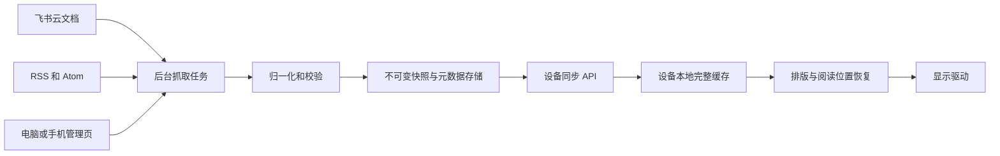

# PaperDIY 内容同步终端需求说明

版本 v0.9｜2026 年 10 月 24 日｜状态：纳入全部飞书文档自动发现、账号授权、Wi-Fi 换环境与界面设计原则的优化基线；产品验收尚未完成。

产品用于把飞书云文档和 RSS 内容同步到 PaperDIY 墨水屏，在断网时继续阅读。首版优先保证内容完整、离线可读、操作可靠和故障可恢复；局部刷新、续航和存储安全分别按实测、功耗积分和发布配置验收。

本文完整替换此前 `docs/spec.md` 的硬件修订稿。原始需求和历史版本分别保存在 [v0.4 原文](reference/requirements-v0.4.md)、[v0.5 硬件稿](reference/hardware-baseline-v0.5.md)、[v0.6 优化稿](reference/requirements-v0.6.md)、[v0.7 配置补充稿](reference/requirements-v0.7.md)和 [v0.8 基线](reference/requirements-v0.8.md)。评审理由见 [需求评审](requirements-review.md)。新增默认值是优化建议，不代表已取得续航或局刷实测结果。

## 1 产品目标与交付范围

首版服务单用户、单设备。用户在电脑或手机上配置源，设备负责阅读和检查更新，不编辑上游文档。

| 范围 | 首版要求 |
|---|---|
| 内容源 | 飞书授权身份可枚举且可读取的全部新版云文档（docx）、最多 2 个 RSS 或 Atom 源 |
| 阅读 | 中文正文、标题、列表、引用、代码、分隔线；图片和复杂元素可识别地降级 |
| 离线 | 已下载文档和文章可从头读到尾；源列表明确标识尚未下载的正文 |
| Wi-Fi | 可扫描或手动输入 Wi-Fi、保存并连接；换环境可离线重配，也可自动连接已保存网络；保留 USB 恢复入口 |
| 飞书应用配置 | 管理页填写 App ID、App Secret，测试凭据并授权飞书账号；自动发现全部文档，无需填写文档链接；代理管理应用及用户令牌 |
| 设备绑定与源配置 | 电脑或手机管理页完成设备绑定和内容源维护；Wi-Fi 重配不清除应用、源或阅读位置 |
| 更新 | 自动定时检查、手动检查；后台更新不抢走正在阅读的位置 |
| 电源 | 电池与 USB 两种策略；翻页不自动联网；无操作后进入深睡 |
| 数据可靠性 | 下载中断、重启、坏数据、代理故障时保留最后一个完整快照 |

后续扩展保留：更多 feed、块级差分、图片缩略、RSS 1.0 RDF、事件触发代理抓取。JSON Feed、受登录保护的 RSS、全文网页抓取、复杂表格排版不进入首版。RSS 文章只显示 feed 实际提供的正文；摘要源标为“摘要”，不承诺完整原文。

## 2 硬件与已验证能力

### 2.1 唯一硬件基线

| 项 | 基线 | 依据与边界 |
|---|---|---|
| 开发板 | M5Stack PaperDIY | 固件识别与官方板级资料一致 |
| SoC | ESP32-S3 v0.2，双核，240 MHz | 设备读取通过 |
| Flash 与 PSRAM | 16 MiB Flash、8 MiB Octal PSRAM | 容量读取、启动内存测试和额外 1 MiB 图案读写通过 |
| 屏幕 | 4.7 英寸，540×960 竖屏，16 灰阶；官方型号 ET047TC1 | 屏幕与灰阶目视检查通过；旧稿 ED047TC1 写法纠正 |
| 屏幕驱动 | 官方 M5GFX 的 PaperDIY `Bus_EPD / Panel_EPD` 路径 | 8 位并行数据与扫描时序；不使用旧稿假设的通用 SPI 控制器或 IT8951 驱动 |
| 用户键 | KEY1 为 GPIO4，KEY2 为 GPIO3，低有效 | 两键事件已实测；GPIO3 涉及启动配置，启动期间行为按板级设计验证 |
| 电源键 | 接 M5PM1；官方定义单击上电或复位、双击关机、长按进入下载模式 | 软件不重定义；这些电源动作仍须单独验收 |
| USB | 已验证原生 USB Serial/JTAG，VID/PID 为 303a:1001 | 业务不依赖 USB-UART 桥；取消“必须割断串口桥”的要求 |
| 电源管理与电池 | M5PM1、140 mAh 标称电池 | 电池容量来自官方规格；本机约 4.19 V 电压读数不等于容量测量 |
| SD 与扩展 | microSD、两个 FPC 扩展口 | 首版不依赖；未做外设、漏电或任意扩展板兼容性验收 |

硬件来源：[M5Stack PaperDIY 官方规格](https://docs.m5stack.com/en/core/PaperDIY_Assembly_Kit)。本项目驱动版本固定在 [组件清单](../firmware/diagnostics/components.lock.json)；实际显示初始化及引脚以该版本源码和官方原理图为准。

GPIO 偏置按原理图和唤醒实测配置，不要求改造为统一 100 kΩ 上拉。未按下的开路按键不会仅因启用上拉就产生 V/R 对地电流；真实耗电取决于漏电、上下拉冲突和外部电路。唤醒所需偏置不能接到深睡会断电的电源域，也不能以悬空 GPIO 的状态做静态电流对比。

### 2.2 实测结果的适用范围

[2026 年 10 月 24 日设备报告](../artifacts/device-check-2026-10-24/report.json)已验证 USB 双向通信、屏幕、两键、Wi-Fi、DNS、SNTP、证书校验、HTTPS 和软件重启后联网。一次重启约 5.7 秒取得 IP；这不是 P95 数据，也不包含飞书取数和应用渲染性能。

尚需验证：SoftAP 完整配网、飞书真实文档访问、局部刷新质量、显示供电关闭后的恢复、GPIO 深睡唤醒、整板电流、实际电池容量和续航。上述硬件报告来自诊断固件；当前业务固件与验证结果见实现进度。

### 2.3 内存和存储预算

540×960 的逻辑 1 bpp 帧为 64,800 字节，双帧为 129,600 字节；4 bpp 帧为 259,200 字节。这些数值不包含驱动内部状态。当前 `Panel_EPD` 源码还分配约 1,036,800 字节的刷新状态缓冲，以及 DMA 和 LUT；不能只按两张 1 bpp 图估算总内存。

排版和 JSON 峰值必须连同驱动、TLS 和 DMA 一起测量，PSRAM 峰值目标不超过 6 MiB。大目录场景的 TLS 动态分配使用 PSRAM，避免与目录字符串争用片内 RAM；显示 DMA 等必须留在片内。Flash 初步预算：两个应用槽合计 8 MiB、字库与资源 2 MiB、缓存 4 MiB、系统分区及余量 2 MiB。分区偏移待固件体积确认；现有诊断固件的单 factory 大分区不能直接用于双槽 OTA。

## 3 用户操作与显示行为

### 3.1 阅读与菜单

| 场景 | KEY1 短按 | KEY2 短按 | KEY1 长按 | KEY2 长按 |
|---|---|---|---|---|
| 正文 | 下一页 | 上一页 | 检查更新 | 返回文章列表并选中当前文章 |
| 文章列表 | 下一篇，末尾循环 | 打开文章并恢复阅读位置 | 下一屏，末屏回到首屏 | 打开菜单 |
| 菜单 | 下一个选项，末尾循环 | 确认 | 检查更新 | 返回上一级 |
| 配网确认 | 取消 | 确认 | 不分配 | 取消 |

开机显示文章列表，每屏 8 篇、标题最多显示两行；未下载正文有明确标记。文章列表中同时短按两键（1 秒内释放）为上一项，首项循环到末项。后台目录更新后按来源与文档 ID 保持选中对象，条目被移除时收敛到有效位置，不能越界或打开错误文章。深睡唤醒保留所在页面与列表选择。

菜单包括文章列表、检查更新、状态、字号、配网、进入休眠。首版固定映射，不开放任意重映射，不使用双击，以消除翻页等待双击判定的延迟。电源键保持硬件语义。墨水屏没有背光开关；“休眠”指停止运算并保留画面，不称为“熄屏”。

按下和释放各稳定 25 ms 才确认状态。释放前未到 1 秒为短按；持续到 1 秒触发一次长按，释放不再触发短按，没有 800–1000 ms 的无响应区间。按键采样独立于网络和显示任务，不能被整屏刷新阻塞。

两键在单键动作尚未触发前同时稳定按下，进入组合键判定；共同持续 3 秒显示配网确认。该按键周期不再触发单键操作；若在 1 秒内释放，作为文章列表的上一项，超过 1 秒提前释放则取消组合键。进入配网前必须先释放全部键，再接受确认事件。

网络操作期间照常翻阅已缓存内容、进入菜单或取消等待。显示波形不可中断时，累计翻页目标并在当前刷新完成后显示最终目标页，不能把操作积压到网络完成后才执行。5 次真实有效短按必须使逻辑页位前进 5 页，允许合并中间画面。

### 3.2 唤醒和恢复

屏幕深睡前的画面本来就可见，唤醒不强制重画缓存页。定时唤醒无变化时保持屏幕完全不刷新。单键唤醒应把该次操作执行一次：按键在应用启动前已释放时，由单键唤醒原因恢复一次短按；仍按住则从最早可采样时刻判定后续操作，不能重复生成短按。

双键唤醒仅进入组合键候选，不生成翻页；长按阈值从固件开始可靠采样两键后计算。验收分别覆盖启动前释放、启动后释放和持续按住，不能把深睡退出描述为普通 GPIO 中断回调。

每次休眠前须确认唤醒键已稳定释放至少 50 ms，避免低电平持续导致立即反复唤醒。长时间卡键时提示异常并临时屏蔽该键的电平唤醒，保留定时与硬件电源键恢复路径。两用户键的 EXT1 ANY_LOW 配置以 ESP32-S3 和当前 ESP-IDF 为准；不假定电源键是第三路 RTC GPIO。

### 3.3 内容更新的可见规则

阅读中收到新版本时，先完整缓存并标记待更新，不自动跳至新文章、不因源失败切换当前阅读源。用户离开正文、主动检查更新或无操作 30 秒后，按阅读锚点应用新版本；重新排版导致页码变化属于正常结果。

正文显示内容版本对应的更新时间。每次检查的时间、错误和抓取新鲜度放在状态页，按用户打开时展示；不为刷新时钟、电量整数或 Wi-Fi 图标单独触发屏幕刷新。严重故障可更新一次明确的状态区，但不得覆盖正文或反复刷屏。

### 3.4 界面设计

设备界面、配网页和电脑或手机管理页统一遵循：避免不必要的次级标签与说明，让布局表达结构和操作关系。

- 用位置、间距、对齐、字号和选中状态组织内容；标题下不重复解释标题，列表项不重复标注已有的字段含义。
- 阅读页以正文为主，菜单突出当前选择。Wi-Fi 列表以网络名称和必要状态为主；IP、连接步骤和诊断信息放在详情或状态页。
- 表单保留清晰的字段名称，不能只用占位文字代替标签；App ID、App Secret 按配置顺序排列，保存后提供账号授权入口，不给每个字段附加常驻解释。
- 权限配置、网络兼容性等帮助通过按需展开或帮助入口提供；仅在首次设置、空状态或用户遇到问题时补充必要引导。
- 错误在对应控件或步骤附近显示一次，简述原因和下一步；必要确认保留，不叠加重复横幅、状态文案和说明段落。
- 墨水屏用文字、形状与选中标记区分状态；网页控件保留可访问名称，含义不能只依赖颜色或无文字的陌生图标。

## 4 系统架构与内容一致性

后台抓取与设备 API 分开。设备定时请求读取已生成的快照，不同步等待一次上游抓取及其多次重试。代理任务调度、快照存储和并发合并需要持久化能力，不能依赖云函数进程内内存。设备首版不直接读取飞书和 feed。

### 4.1 三层对象与版本

`source` 表示一篇飞书文档或一个 feed；`document` 表示可阅读的整篇内容；RSS 的每个 `item` 对应一篇独立 document。Feed 的目录和文章正文分开，不能把“源分页”“文章分页”和“设备屏幕页码”混用。

| 字段 | 规则 |
|---|---|
| source_id | 代理分配的稳定 ID；编辑源地址不自动换 ID，需重新验证地址与权限 |
| document_id | 飞书文档稳定 ID，或 feed 范围内持久化的文章 ID |
| upstream_revision | 上游版本，仅用于抓取；可为空，视为不透明字符串 |
| content_revision | 规范化可显示内容的完整 SHA-256；不混入检查时间或 HTTP ETag |
| catalog_revision | 源目录和条目顺序的内容版本，独立于正文版本 |
| body_revision | 源内正文快照引用的聚合版本；正文完成抓取时触发清单变更，不使目录分页失效 |
| snapshot_id | 不可变快照标识，关联明确 schema、字节数和整体校验值 |
| content_updated_at | 上游内容时间；未知时为空并标记时间来源，不用抓取时间冒充发布时间 |
| content_created_at | 上游文档创建时间；用于飞书文章日期的回退，未知时为空 |
| fetched_at 与 checked_at | 抓取成功时间与检查时间，属于运行状态，不驱动内容版本变化 |
| schema_version | 内容模型版本；未知主版本拒绝应用，保留旧快照 |

网页与终端文章列表按文章日期倒序。飞书依次取标题中的有效年月日、上游文档创建时间、上游更新时间；RSS / Atom 取源提供的文章时间。标题日期按北京时间解释，其余时间统一转换后比较；无有效日期的排最后，同一日期按稳定文档 ID 排序。先对完整目录排序再分页，抓取与检查时间不参与排序。

### 4.2 内容块与阅读位置

块包含 `block_id、type、text、depth、meta、hash`，必要时包含链接、图片占位与图片资源引用。`hash` 覆盖所有影响渲染的规范化字段，包括列表起始序号、图片尺寸和图片版本，不能仅计算 text/type/level。整体版本还覆盖标题、块顺序和结构。

目录标题最多 256 个码点，超长显示摘要并保留正文中的完整标题；单块文本初始上限 64 KiB。各输入字段和集合均定义长度上限，资源超限按明确规则截断或拒绝，不能依赖隐含固定缓冲区。

飞书按块树的父子关系和 children 顺序遍历；表格、列表和引用不能靠接口返回数组顺序直接拼接。RSS 的段落 ID 由代理维护，修改时尽量匹配旧段落；不把位置序号当成跨版本稳定 ID。

阅读锚点为 `{source_id, document_id, content_revision, block_id, offset_codepoints}`；字符偏移明确为规范化 UTF-8 文本的 Unicode 码点数。排版不得拆开组合字符。块被删除时，按旧版本相邻块顺序寻找存续锚点，再按可匹配文本恢复，最后回到文档开头并提示位置已调整。每个源和每篇文章独立保存位置。

### 4.3 首版同步与后续差分

首版采用“轻量清单条件请求＋变化文档的完整快照”，先验证内容正确性。快照最多 500 块、300 KiB 规范化 UTF-8 JSON，包含结构开销；超限可输出明确标注 `truncated=true` 的完整块前缀，并提供原文链接。不能把截断内容称为摘要，也不引入模型自动总结。

块级差分作为后续优化，必须包含 `base_revision、target_revision、schema_version、目标块顺序、upsert、delete、目标整体 hash`。只在基准精确匹配且补丁更小时使用；缺基准、坏补丁、乱序或基准过期均回退完整快照。客户端不得把不同版本的片段拼为当前文档。

## 5 设备与代理协议

首版协议主版本为 v1。版本放在 URL 和 `X-Protocol-Version` 头中；JSON 有实体时携带 `schema_version`。鉴权和版本检查先于条件请求判断，未授权请求不能得到 304。

| 接口 | 用途与要求 |
|---|---|
| `GET /v1/sync` | 返回该设备允许访问的源清单及快照引用；正文上限 8 KiB；带 Authorization 和 If-None-Match |
| `GET /v1/sources/{id}/catalog` | 指定目录版本的分页元数据；cursor 绑定目录版本，不用于设备屏幕翻页 |
| `GET /v1/snapshots/{id}/chunks/{index}` | 下载不可变快照的固定块；单块最多 32 KiB；首版不做压缩，限制与校验均按原始字节 |
| `POST /v1/refresh` | 手动请求后台检查更新；可返回 202 和任务 ID，受限流约束 |
| `GET /v1/status` | 手动状态查询，返回代理、上游授权及抓取状态；不驱动周期性屏幕刷新 |

清单给出快照字节数、分块数量、每块 SHA-256 和整体 SHA-256。cursor、快照 ID、资源路径均须校验设备访问权限，知道 ID 不代表有权限。过期 cursor 返回 `SNAPSHOT_EXPIRED`，设备重新取清单；正在分块下载的快照在下载租约内保留，首版租约至少 24 小时。

单个源的授权、抓取或解析失败不得使其他源或整个设备清单失效。设备凭据仍有效时，清单继续返回允许访问的源和已有快照引用，单源故障通过状态通道报告；不把上游授权故障转换成设备级 401。

304 没有响应正文，不能携带 JSON 版本或状态对象。条件响应的 ETag 只代表稳定清单实体；抓取状态可通过响应头或独立状态接口返回，不能把每次变化的 fetched_at 塞进清单实体却复用同一个强 ETag。304 不表示无需唤醒或联网，只表示无需重新下载实体。[HTTP 语义依据](https://www.rfc-editor.org/rfc/rfc9110.html#section-15.4.5)

### 5.1 下载和提交

1. 将新快照写入非活动文件，逐块校验；断网时保留旧活动快照。
2. 全部下载后检查整体 hash、schema、唯一块 ID、结构、大小限制和可用空间。
3. 通过事务或可恢复的原子切换更新活动索引，保持至少一个旧的完整版本。
4. 排版完成后单独提交显示状态，分别记录 `active_snapshot_id` 与 `displayed_snapshot_id`，待显示的旧快照不得提前清理。下载完成不能等同于屏幕刷新完成。
5. 显示前记录“刷新未完成”；驱动确认波形结束后清除。重启发现未完成、基准丢失或布局版本不匹配时全刷恢复。

断电恢复后只能读到完整旧版或完整新版，不能读到混合版。内存不足、缓存满、非法 JSON 和缺字库等错误必须有确定降级，不能清空屏幕。

### 5.2 错误与恢复责任

| HTTP 与业务状态 | 处理 |
|---|---|
| 401 `DEVICE_TOKEN_INVALID` | 停止自动业务重试，提示重新绑定；不要求重配 Wi-Fi |
| 403 `SOURCE_ACCESS_DENIED` | 管理页修复该源权限；保留旧内容，其他源继续工作 |
| 上游令牌过期 | 代理刷新令牌并至多重试一次；刷新失败才显示 `UPSTREAM_AUTH_REQUIRED`，不能伪装为设备 token 失效 |
| 429 `RATE_LIMITED` | 尊重 Retry-After；手动操作也不得绕过服务端限制 |
| `PARSE_ERROR`、`UPSTREAM_TIMEOUT`、上游 5xx | 保留快照，标记 stale，后台稍后重试；不转为永久删除 |
| 404 或 410 `SOURCE_GONE` | 根据源适配器确认与持续性策略标记不可用；不自动切换正在阅读的页面 |
| `SOURCE_UNSUPPORTED`、`CONTENT_TOO_LARGE` | 显示具体限制；保留旧内容，不无限重试 |
| 409 `BASE_MISMATCH` 或 `SNAPSHOT_EXPIRED` | 获取新清单和完整快照 |
| 426 `UPGRADE_REQUIRED` | 停止应用不兼容内容，保留缓存并提示升级 |
| `TIME_UNSYNCED` | 恢复可靠时间后再建可信 TLS；不关闭证书校验 |

手动检查先检查代理现有版本，再按额度发起 refresh；在本次设备网络预算耗尽后显示“更新处理中”，下一次检查接续。它不承诺绕过上游限流或等待任意慢源完成。

## 6 上游取数与 RSS 规则

### 6.1 飞书授权和一致性

同步全部可枚举的文档，不要求逐篇填写链接或选择目标文档。个人云盘采用用户 OAuth；仅配置应用凭据时，范围限定为应用身份可枚举的目录和知识库。接入验证必须读到元信息、全部 blocks 分页、嵌套块及可识别正文，并覆盖修改后更新和权限撤销；只读到标题与 revision_id 不足以通过。

自动发现从云盘根目录、知识空间列表与用户个人文档库 `my_library` 开始，递归文件夹和知识库子节点，处理所有分页；空页但 `has_more=true` 时继续。按 docx 的真实对象 ID 去重，目录循环和快捷方式不能造成重复抓取。表格、旧版 doc、附件暂不转换为阅读正文；单独分享且未进入可枚举目录的对象不能承诺被目录 API 发现。“全部”不等于全租户或无权限的数据。

目录遍历游标、待抓正文、错误和退避时间持久化，代理重启后接续；单篇正文失败不阻塞其他文档。完整且成功的目录遍历后才从活动目录移除已消失的文档；部分目录无权限、响应错误或分页不完整时保留旧完整正文，不把部分结果视作删除依据。管理页详情提供发现、成功和失败数量，失败条目可定位。

代理目录不应用 RSS 的 50 条截断。设备分页取得紧凑目录，超过单次联网预算时保存进度，在下一次检查接续；完整目录校验后才替换活动索引。设备保留每个源前 5 篇正文及按需下载的当前文章，代理仍同步全部正文。设备目录索引预算为 512 KiB，超过容量须明确提示并保留旧缓存，不能静默丢掉后续文档后声称全部完成。大量正文由管理页预览，按需下载至设备。 目录分页与断点进度依据目录版本校验；仅有正文快照或同步错误变化时，清单可更新，但不能使已下载的目录分页进度失效。

用户授权使用 `https://accounts.feishu.cn/open-apis/authen/v1/authorize`，授权码及刷新令牌在代理调用 `POST https://open.feishu.cn/open-apis/authen/v2/oauth/token` 交换。申请 `drive:drive:readonly`、`docx:document:readonly`、`wiki:wiki:readonly`、`offline_access`；在应用安全设置中登记管理页展示的回调 URL。用户令牌及滚动 refresh_token 加密持久化、并发合并刷新；授权失效时不自动降级到应用身份。新账号授权成功后重建飞书私有目录和缓存，RSS、Wi-Fi 与设备绑定独立保留。[官方 CLI 的 OAuth 端点](https://github.com/larksuite/cli/blob/main/internal/auth/paths.go)、[知识空间与个人文档库说明](https://github.com/larksuite/cli/blob/main/shortcuts/wiki/wiki_space_list.go)。

抓取分页尽量固定上游文档版本；适配器不支持固定版本时，抓取前后复核 revision，变化则放弃该次结果并重新调度。不得发布混合修订。接口分页上限属于上游能力，500 块属于本产品上限，两者分开配置。

代理通过官方 SDK 或所选正式接口管理 token，按返回的 expires_in 缓存和提前更新，不硬编码 token 长度与寿命。当前官方凭证接口已提供新的 JWT 返回形式，接入时需固定所选接口与 SDK 版本。[飞书凭证说明](https://open.feishu.cn/document/uAjLw4CM/ukTMukTMukTM/authentication-management/access-token/tenant_access_token)

#### 凭据换取与令牌续期

已核实飞书自建应用可用 App ID 和 App Secret 获取应用身份的 `tenant_access_token`，不需要用户手工复制令牌。首版优先采用官方当前的 client credentials 接口：

| 项 | 契约 |
|---|---|
| 方法与地址 | `POST https://accounts.feishu.cn/oauth/v3/token` |
| 请求格式 | `application/x-www-form-urlencoded`；采用请求体凭据认证，不同时发送 Basic 凭据 |
| 参数 | `grant_type=client_credentials`；`client_id` 对应用户填写的 App ID；`client_secret` 对应 App Secret |
| 成功结果 | `access_token` 是本应用的 tenant_access_token；按 `expires_in` 秒计算失效时间，token_type 为 Bearer |
| 后续云文档请求 | 使用 `Authorization: Bearer <access_token>`，令牌只在代理服务内部使用 |

这是不需要用户交互授权的应用身份流程。它不会仅凭 App ID 和 App Secret 产生用户身份的 user_access_token。应用需处于可用状态、具备相应云文档只读权限，且被授予目标文档访问权；换到令牌与能读取完整正文分两步验证。

历史 SDK 使用 `POST https://open.feishu.cn/open-apis/auth/v3/tenant_access_token/internal`，请求字段为 `app_id/app_secret`，与上述新接口的字段和响应不能混用。若适配已有部署，按该版本的正式契约单独实现兼容适配；首版不在失败时盲目轮流尝试不同鉴权接口。[官方历史 SDK 示例](https://github.com/larksuite/oapi-sdk-java/blob/v2_main/sample/src/main/java/com/lark/oapi/sample/rawapi/RawApiCall.java)

代理按应用配置版本缓存令牌，采用应用级并发合并，避免多个设备同时重复换取；在 expires_in 对应的截止时间之前留出余量重新换取。平台返回令牌失效时失效旧缓存并至多重新换取一次、重放一次原只读请求；凭据无效、应用不可用或策略拒绝时停止循环重试并显示对应修复入口。不能把 HTTP 200 单独视为成功，仍须校验业务错误、令牌字段和有效期。

App ID 或 App Secret 更换并成功提交后，失效旧配置的令牌缓存及未完成任务结果；重启从服务端保存的凭据重新获取令牌。管理页显示验证状态，令牌失效时间放在详情中，不展示 token 全文。应用取令牌已通过真实凭据测试；用户 OAuth、全目录和真实正文仍须在账号授权后接入测试。

应用身份只处理其可枚举目录；个人云盘使用代理托管的用户 OAuth，重授权通过管理页完成。目录或正文权限不足时按具体失败对象修复。设备只展示源授权异常，不保存飞书 app_secret、access_token 或 refresh_token，也不把飞书重新授权绑到 Wi-Fi 配网。

### 6.2 后台调度

飞书默认每 5 分钟检查，RSS 默认每 30 分钟检查；RSS 可选 10、15、30、60、180 分钟。每个上游只保留一个并发抓取任务，代理出站抓取总并发初值为 2，按持久化队列调度。多设备共享相同授权范围的抓取结果，不跨用户共享私有内容。

单次上游连接预算 5 秒、请求总预算 15 秒。瞬态失败由后台任务延迟重试，带抖动并尊重 Retry-After，不在设备请求内执行 1/4/9 秒的串行等待。单次任务最多 3 次尝试，持续失败进入逐步延长的调度间隔。

### 6.3 条目身份与保留

优先使用 feed 范围内的 RSS guid 或 Atom id；相同 guid 出现在不同 feed 中不得串条目。没有 ID 时优先使用规范化链接；发布时间不是身份组成部分，文章改时间仍是同一条目。没有稳定 ID 和链接时分配持久化 ID，并将匹配能力不足视为降级情况。

URL 规范化仅处理有明确定义的等价形式，例如 scheme 与 host 大小写、默认端口；保留 path 大小写、结尾斜杠和有语义的 query。UTM 去重只对已配置的跟踪参数规则生效，不全局改写任意链接。[RSS 规范](https://www.rssboard.org/rss-specification)与 [Atom id 定义](https://www.rfc-editor.org/rfc/rfc4287.html#section-4.2.6)

条目从滚动 feed 中消失不等于删除。代理按条目 ID 合并历史，再按配额和最长保留期清理。代理每 feed 最多 50 条目录和 20 篇正文，最长保留 7 天；容量上限先于时间保留，不能同时承诺高频源“至少保留 7 天且最多 20 篇”。当前阅读条目在会话期间固定保留。

设备首版保留每 feed 最近 50 条目录、最近 5 篇已下载正文，并固定保留当前文章。单篇 RSS 正文最多 64 KiB；未缓存文章显示“需要联网下载”，不得表现为损坏或白屏。

目录携带正文是否仍可下载的标志；代理已淘汰正文时显示“正文已过期”和原文入口，不承诺联网后必然恢复。首次打开文章才标记已读，预下载不改变已读状态；正文更新不清除已读状态，新条目数依据稳定条目 ID 计算。已读状态首版只保存在本机。

### 6.4 解析与资源边界

支持 RSS 2.0 和 Atom 1.0；按 namespace URI 识别结构，不仅比较标签本地名。Atom text、html、xhtml 按其声明解释，不把转义 HTML 当普通标签直接删除。RSS 1.0 RDF 后续再加入兼容集。

响应在压缩传输前后均设 2 MiB 硬上限，并限制 XML 深度、节点数、解码后的单篇正文和解析耗时。超限应中止并保留旧快照，不能截断 XML 后声称取得“最近 20 条”。禁用 DTD、外部实体和外部资源自动加载。

字符集依据格式和可信编码声明解码；对已确认的历史源可使用受测 GB18030 兼容规则。解码无法可靠完成时返回解析错误，不无条件转为 Latin-1 以掩盖乱码。输出统一 UTF-8，非法字符替换和缺字占位可诊断。

清洗移除脚本、样式、可执行属性和危险链接；保留正文、结构、可见链接和图片占位。图片首版不抓取原图，不要求设备从不受信任的任意 URL 下载资源。后续缩略图由代理处理，最长边 96 像素，每篇最多 3 张，资源 hash 进入内容版本。

### 6.5 代理出站访问

RSS URL、重定向地址及后续图片 URL 都是非可信输入。首版只接受公开网络 HTTP/HTTPS，默认优先 HTTPS；拒绝 localhost、私网、链路本地、云元数据地址和非 HTTP 协议。DNS 解析、实际连接与每次重定向都需复核目标，不能只检查初始 URL；凭据不得随重定向发送至不同源。[OWASP SSRF 防护依据](https://cheatsheetseries.owasp.org/cheatsheets/Server_Side_Request_Forgery_Prevention_Cheat_Sheet.html)

## 7 渲染与缓存

首版支持标题 h1–h3、段落、有序和无序列表、引用、代码、分隔线、链接文本、图片占位与表格线性文本。列表深度至少 2 层，超过部分保留缩进标记；代码采用等宽字体，提供软换行或可识别的截断标记，不能静默丢弃长行。表格按行输出列名和值，保持可理解的读取顺序。

中文默认字号建议 24 像素，可选 16、24、32；首次提供样例预览。具体默认字号根据实际屏幕阅读效果调整，不远程强制改写用户字体。字库覆盖常用中文和英文，缺字显示占位并记码点，不宣称有限字库能覆盖任意 RSS 正文。

布局缓存键包含内容版本、字体版本、字号、屏幕方向、边距和排版版本。插入一句话可能使后续内容重排，块级变化范围不等于像素变化范围；每次先完成新布局，再判定当前屏幕变化。

使用经验证的驱动局部更新能力。首次启动、字体变化、刷新未完成、旧帧基准未知、残影明显时走完整当前页刷新。原稿“任意追加一句窗口不得超过 25%”不作为通用验收；仅在固定行高、不会引发重排的测试样例上检查小窗口能力。

驱动窗口日志只证明请求范围，前后帧缓冲比较只证明逻辑像素变化；是否影响窗口外的实际显示须配合录像和照片确认，不能由软件统计直接推断“不整屏闪”。

局刷初始策略：可见变化包围矩形按驱动要求对齐；窗口超过屏幕 40% 时允许全刷；连续 20 次局刷或累计请求面积达到 3 屏后，在下一次确实需要显示更新时全刷。这些是可调初值，须用残影和功耗测试确定。单纯经过 45 分钟不唤醒或刷新设备；低温不默认全刷，按可测温能力和已验证波形选择策略，首版不额外依赖温度传感器。

深睡会丢失普通 RAM 和 PSRAM，也会丢失驱动里的刷新状态。允许从本地完整快照、上次已显示版本和布局键重建旧帧，但能否恢复驱动基准必须实测；不能恢复就全刷，不承诺“深睡后任意局刷且绝不全屏闪”。

内容缓存使用文件系统并做磨损均衡，NVS 保存少量配置和索引。内容不变、配置不变、用户无操作的稳定轮询不得写业务 Flash 或驱动屏幕。阅读位置、内容提交、异常状态转变属于另行计数的必要写入。

阅读位置先记 RTC 保留内存并附 CRC；累计 5 次翻页、空闲 30 秒或正常深睡前择先检查点提交。正常休眠不丢位置；意外硬断电允许回退到最近检查点，最大丢失 5 页或 30 秒内进度。缓存满时先清理未固定条目，保持旧活动版本；无法安全容纳新版则报告空间不足。

## 8 功耗与更新时延

### 8.1 两种运行策略

| 配置 | 电池模式建议默认 | USB 模式建议默认 |
|---|---|---|
| 自动检查间隔 | 60 分钟 | 5 分钟 |
| 可选间隔 | 5、15、30、60、180 分钟；短周期显示实测耗电提示 | 1、5、15、30、60 分钟 |
| 翻页 | 只读本地缓存，除正文未下载外不联网 | 同左 |
| 手动检查 | 立即向代理检查；尊重限流与本次执行预算 | 同左 |
| 无操作 | 网络操作结束即关 Wi-Fi；低功耗阅读等待最多 15 秒后深睡 | 允许持续响应输入，仍关闭无用无线连接 |

供电状态检测用板级电源管理接口，并需验证插拔时的去抖和策略切换。关闭或屏蔽当前画面不属于进入深睡的前提。

阅读等待必须使用实测通过的轻睡或等效低功耗状态；若暂不具备，默认在波形完成、按键释放和检查点提交后 1 秒内深睡，不能让 CPU 保持活跃空转 15 秒。所有阅读等待开销计入续航。

正常定时无变化唤醒的活跃时间目标为 P95 ≤15 秒；从唤醒到深睡的硬预算为 30 秒，不含配网、OTA 和用户持续阅读。单次联网预算最多 20 秒，瞬态错误仅在预算允许时额外尝试一次。超预算保留旧内容并睡眠，不为了完成重试阻塞到一分钟以上。

失败退避的间隔不得小于当前自动检查周期，连续失败逐步增加，最长 6 小时并加抖动；Retry-After 可要求更长等待。退避小状态优先留 RTC 保留内存，重要状态变化再做持久化。完全断电后无法保留 RTC 时由代理限流兜底，不每次唤醒都写 NVS。手动检查有 30 秒本地冷却，不能绕过服务端限制。

### 8.2 电池模型和续航目标

140 mAh 是标称容量。112 mAh 仅是暂按 80% 可用作规划的假设，须按电池截止电压、负载、温度和老化测量修订。整板深睡 ≤200 µA 是待测工程目标，不是设备诊断报告的已通过项。

规划公式：`Qday = Isleep × Tsleep + Nsync × Qsync_avg + Qread + Qother`，电量单位为 mAh。Qsync_avg 包括关联、DHCP、校时需要时的开销、TLS、下载、校验和必要显示。P95 时长不能冒充平均单次电量。

仅为比较策略，暂取每次联网 120 mA×12 秒，即 0.4 mAh，深睡以 0.2 mA×24 小时保守近似，每天另有 10 次手动联网：

| 自动间隔 | 自动次数每天 | 自动与手动联网加深睡 | 112 mAh 规划可用容量除以该耗电 |
|---|---|---|---|
| 5 分钟 | 288 | 124.0 mAh 每天 | 约 0.90 天 |
| 15 分钟 | 96 | 47.2 mAh 每天 | 约 2.37 天 |
| 30 分钟 | 48 | 28.0 mAh 每天 | 约 4.00 天 |
| 60 分钟 | 24 | 18.4 mAh 每天 | 约 6.09 天 |

表中仍未加入额外阅读和其他开销，不能当作续航承诺，也不能据此断言优化后的短周期一定无法达到目标。60 分钟默认是为 5 天目标预留空间的建议；若实测单次联网电量显著降低，可重新评估较短周期。

电池发布参考工况：25±3°C、60 分钟自动检查、手动联网最多 10 次每天、20 次翻页每天、2 次内容更新每天、首版源数量、不做 OTA、不插 USB、无线信号 −50±10 dBm。记录正常阅读等待、源抓取失败和内容更新比例。每日总电量目标 ≤22.4 mAh，满足这一预算且实测可用容量 ≥112 mAh 后，才能用模型支持“预计至少 5 天”；正式续航通过还需实际放电运行验证。

24 小时功耗积分用于发现问题，不自带“误差 ±10%”保证。量产前须覆盖多次工作周期和完整放电，公开测量条件及离散范围。深睡不达标时优先分析实测分项；不能从整板电流里扣除仍在电池取电的部件，也不能把失败后的指标反而改成更严格的 50 µA 并称为回退。

### 8.3 时延的完整口径

自动更新的规划上界包括：`上游检查周期 U + 设备检查周期 D + 任务排队 J + 设备取数显示 T`。例如 RSS 每 30 分钟抓取、电池每 60 分钟检查，仅 U+D 就可接近 90 分钟。上游成功率、代理缓存新鲜度和设备同步成功率分开统计。

验收分别测量“代理已有新快照到设备完成显示”的延迟与“上游修改到设备显示”的延迟。只有后者包含 U 和 J。手动检查不承诺上游尚未抓取时立即显示新内容；USB 模式或缩短源抓取周期可降低等待，但需计入成本与能耗。

## 9 配置与安全

源配置由代理管理页作为权威，设备保存版本化只读副本；Wi-Fi 和硬件设置由设备管理。修改离线设备配置不能在两个位置静默覆盖，使用 config_revision 和冲突提示。设备 token 仅能读取允许的源和调用受限 refresh，不能拿设备 token 管理其他设备或修改全部源。

### 9.1 Wi-Fi 配置与换环境

Wi-Fi 首次配置、更换网络、编辑密码、忘记网络和重新连接均属于首版功能。设备最多保存 5 组网络配置，足以保留家中、办公室与手机热点；每组记录 SSID、安全类型、密码和优先级。网络名称按 UTF-8 字节校验，支持手工输入隐藏 SSID。首版必测 2.4 GHz WPA2-Personal；纯 5 GHz、企业 802.1X 和网页认证门户不纳入首版适配范围。兼容性要求放在帮助入口；检测到不支持的网络时，就地提示改用受支持的个人 Wi-Fi 或手机热点。

| 场景 | 行为 |
|---|---|
| 首次使用、没有网络配置 | 显示设备热点名称、配网密码和访问地址；手机或电脑连接后扫描并选择 Wi-Fi，也可手动填写 |
| 回到已保存环境 | 优先最近成功且当前可用的网络，其余按用户优先级和信号选择；每次唤醒仍受联网总预算与尝试次数限制 |
| 到达未保存环境 | 屏上旧内容保持可读，提示网络不可用；通过实体按键进入配网，无需原路由器、旧 IP 或互联网即可填写新 Wi-Fi |
| 新网络连接成功 | 验证关联与 DHCP 后保存新网络；单独测试代理 HTTPS 可达性。主界面显示当前 SSID 与连接结果，IP 和各步骤状态放在详情中 |
| 密码错误或网络不存在 | 保留已保存的可用网络和配网会话，显示具体失败原因，允许修改重试；不清除阅读缓存 |
| Wi-Fi 已连、代理不可达 | 明确显示“Wi-Fi 已连接，代理未连接”；不把 DNS、校时、代理或飞书故障误报为 Wi-Fi 密码错误 |
| 忘记当前网络 | 仅在用户明确操作后删除该网络，再选择其他已保存网络或进入重配入口 |

断网后不能依赖云端指令才能打开配网页；两键配网入口在业务鉴权失败时也必须可用。临时掉线不自动永久开启 SoftAP，避免持续耗电；首次无配置与用户明确进入配网时才开启，按会话超时关闭。

新配置作为候选验证，失败不覆盖同名网络的旧有效密码；新增第 6 组时明确选择替换对象，不静默丢弃。Wi-Fi 重配不恢复出厂、不重新绑定设备，也不清除飞书应用配置、源配置和阅读位置。周期重连的最近成功状态优先更新内存或 RTC，仅选网变化和配置提交时持久化，避免每次检查写 NVS。

### 9.2 飞书应用配置

已认证的电脑或手机管理页提供“飞书应用”设置，首版支持一个自建应用配置；独立于本地 Wi-Fi 配网页。推荐顺序为先连接 Wi-Fi，再进入代理 HTTPS 管理页填写应用凭据并授权飞书账号。App Secret 直接提交给代理，不经设备中转或保存到设备 NVS。

| 配置或操作 | 要求 |
|---|---|
| App ID | 必填，可显示和修改；与 App Secret 成对校验 |
| App Secret | 首次必填；密码输入框只写不回读，后续显示“已设置”；不修改时明确保留旧值，修改 App ID 时必须同时提供对应新 Secret |
| 全部文档 | 不显示文档链接输入框；授权后递归同步所有可枚举且可读取的 docx；“如何授权”内提供权限清单与回调地址 |
| 测试应用凭据 | 由代理换取令牌，显示“通过”或应用不存在、凭据不匹配、应用未启用、平台策略拒绝、网络错误等具体分类 |
| 测试文档访问 | 自动发现授权目录，另行验证各文档元信息与正文分页；应用凭据通过但文档无权限时引导修复文档或 scope，不要求重新配 Wi-Fi |
| 保存与更新 | 新凭据验证成功后再原子替换活动配置；验证失败保留旧有效配置；明确展示源权限仍待处理的状态 |
| 移除飞书配置 | 用户明确确认后停用飞书抓取并清理代理凭据、令牌缓存；RSS 与 Wi-Fi 配置独立保留 |

管理页使用独立的用户或管理员认证，不能凭设备 token 写入 App Secret。服务端凭据采用受保护的密钥存储，按权限解密使用；配置查询、备份导出和审计日志不回传 Secret 或令牌。用户正常使用只需管理 App ID、App Secret 与账号授权，令牌换取和续期由系统处理。

### 9.3 绑定与存储保护

首次绑定使用管理页签发的单次配对码，短时有效、限速、一次消费；成功后签发至少 256 位随机 device_token。Wi-Fi 重配、设备重新绑定、飞书重新授权分别提供入口。撤销设备凭据后，下一次请求在读取缓存和判断 304 前拒绝，旧设备上已有的离线内容只能通过本地清除移除。

SoftAP 必须由首次启动、USB 恢复或实体按键确认开启，使用随机 WPA2 密码和短时会话，5 分钟无操作关闭，成功提交网络配置后关闭。写配置接口绑定配网会话和实际 AP 访问通道，不能仅凭目标 IP 或存在该网页就允许局域网修改。用户提交的 Wi-Fi 密码不回显、不进入日志；关联与 DHCP 决定 Wi-Fi 配置结果，可信 TLS、代理绑定和飞书访问作为后续独立检查，不相互混报。

时间统一存 UTC、时区只影响显示。正常深睡使用保留时钟，不每次唤醒都等待 SNTP；建议每天或漂移明显时校时。完全断电后时间不可信时走有时限的时间恢复流程，失败保留缓存和错误状态，不跳过证书、主机名或有效期检查。

| 发布层级 | 安全要求 |
|---|---|
| 开发样机 | HTTPS、随机可撤销设备凭据、最小权限、日志脱敏和受控调试；不得宣称已实现物理读取保护 |
| 面向实际私有文档的发布版本 | 签名固件、Secure Boot、Flash Encryption 与对应 NVS 密钥保护；正文缓存也纳入存储保护；验证恢复和升级流程 |

Flash Encryption 等配置涉及 eFuse 和后续恢复能力，必须作为独立发布步骤，完成密钥托管、备用设备验证、恢复演练和明确操作授权后执行，不能在普通构建或诊断脚本中自动启用。[ESP32-S3 Flash Encryption 说明](https://docs.espressif.com/projects/esp-idf/en/v5.5.5/esp32s3/security/flash-encryption.html)

日志只保留事件码、时长、字节数、状态、原因码和非敏感关联 ID；不记录正文、密码、Authorization、配对码或含凭据的完整 feed URL。设备导出日志需要实体操作或已认证管理会话。

## 10 OTA 与故障恢复

发布版使用两个应用槽，下载完成先验证签名与镜像完整性，再切换启动。首次启动通过配置读取、缓存兼容性、显示和基本调度自检后标记有效，否则由 bootloader 回滚；网络暂时不可用不能单独判定固件损坏。

升级、配置和缓存格式均需版本迁移策略。回滚后的旧应用必须能读取仍保留的旧格式，不能在新应用确认前不可逆删除旧数据。防坏版本回滚与基于安全版本号的防降级是不同机制；更新安全版本下限前须确认旧救援路径的影响。

配网和 OTA 不受普通 30 秒唤醒预算限制，单独设置超时和电量条件。OTA 首版发布时只允许稳定 USB 供电；电池 OTA 后续验证再开。现有分区迁移先通过 USB 维护流程完成备份及恢复演练，不把改分区表当普通应用 OTA。

## 11 分期交付与进入条件

| 阶段 | 交付 | 进入下一阶段的条件 |
|---|---|---|
| G0 技术验证 | 基础硬件、真实 App ID/Secret 换取应用令牌、实际飞书正文权限、单个 feed、局刷探针、两键深睡唤醒、关屏供电恢复和电流测量 | 关键能力有证据或有明确可接受降级；已有硬件诊断只关闭其中部分项目 |
| G1 功能首版 | 全部可访问 docx 与 2 feeds、SoftAP 换环境与多组 Wi-Fi、飞书应用配置和自动续期、完整快照、离线阅读、事务缓存、固定按键、状态页和两种供电策略 | 核心流程与故障注入通过，不依赖块级差分 |
| G2 发布可靠性 | 局刷优化、实测能耗、OTA 回滚、存储保护、授权修复和 72 小时稳定性 | 发布验收通过；续航口径与实际测量一致 |
| G3 扩展 | 增量补丁、更多源、缩略图、RDF、可选事件驱动代理更新 | G1/G2 结果不回退，各能力单独验收 |

局刷不能作为网络、缓存、深睡和 RSS 的共同前置依赖。若局刷不满足质量，首版允许整页刷新并调整体验说明。事件推送只降低代理上游等待，不承诺唤醒处于深睡且无线关闭的设备。免费额度与开发人日不作为需求保证；选定部署平台后列出请求、调度、存储、流量和冷启动实测预算。

## 12 验收条件

以下为产品待执行用例。历史硬件诊断不代表这些用例已经完成。所有百分比报告样本数、环境和失败原因；网络性能样本至少 100 次。稳定性中的“异常重启”排除预期的深睡唤醒、人工复位和 OTA 重启。

| ID | 用例与测量 | 通过条件 |
|---|---|---|
| AC-01 | 用手机完整加入 SoftAP、提交配置、绑定代理；3 次完全断电重启 | 均恢复配置并可同步；错误密码可修复；AP 自动关闭；无密码日志 |
| AC-02 | 授权账号的云盘与知识库，含分页、嵌套块、修改和撤权 | 全文结构正确；修改可见；撤权分类准确；元信息成功不单独算通过 |
| AC-03 | 固定版本跨页抓取期间持续修改文档 | 不发布混合修订；明确重试或继续展示旧完整版本 |
| AC-04 | 内容与配置不变，无用户操作的 100 次定时检查 | 304 或等价版本命中；正文传输 0、屏刷新 0、业务 Flash 写入 0；状态时间仅在查看时显示 |
| AC-05 | 两个不同源的新条目与更新条目 | 目录、正文和版本不串源；当前阅读位置不被后台更新抢走 |
| AC-06 | 分块下载中断、坏 hash、重复或遗漏块、混入另一快照 | 新版拒绝提交；完整旧版可读；可从清单恢复 |
| AC-07 | 在写快照、切索引、显示开始与结束等点断电，每类至少 10 次 | 只出现完整旧版或新版；无混合内容；未完成刷新能恢复 |
| AC-08 | 断网后将已下载文档和文章从头读到尾 | 全文可读；未下载文章明确提示；源失败不自动跳走 |
| AC-09 | 修改锚点前文本、删除当前块、调整字体与页尺寸 | 按锚点规则恢复；无越界或静默错误位置；各源进度独立 |
| AC-10 | 标题、列表、引用、长代码行、表格、链接、图片、生僻字样例 | 无越界；降级有标识；代码截断可识别；缺字可定位 |
| AC-11 | 连续和快速短按、长按边界、网络同步与全刷期间输入 | 单次有效事件不重复、不丢失；5 次有效翻页目标累计 5 页；无时间死区 |
| AC-12 | 1–10 ms 电气抖动与 25 ms 以上真实按键分别注入 | 抖动不额外产生事件；真实有效操作按规则计数，不能把 40 ms 短按全部当抖动 |
| AC-13 | 单键与双键深睡唤醒、启动前释放、持续按住、卡键各至少 30 次 | 对应动作确定且仅一次；无唤醒风暴；恢复输入目标 P95 ≤1.5 秒，不以重画旧屏为指标 |
| AC-14 | 小矩形文字替换与引发整页重排分别测试 | 前者验证对齐窗口与窗口外像素不变；后者允许全刷；波形完成时间和可见效果分别记录 |
| AC-15 | 连续 100 次页面变化、深睡恢复、屏供电关闭后重开、刷新中断 | 无花屏；残影按固定样例与照片评价；局刷质量不合格时可可靠全刷恢复 |
| AC-16 | RSS guid 重复、时间改变、同 ID 跨源、链接路径及尾斜杠变体、滚动条目消失 | 去重符合定义；不误删历史正文；不错误合并不同链接 |
| AC-17 | Atom text/html/xhtml、RSS 正文与摘要、UTF-8 与受支持 GB18030 | 正文与结构正确；解码失败明确分类；不以 Latin-1 乱码冒充成功 |
| AC-18 | 超大 XML、压缩膨胀、DTD/外部实体、私网 URL 与重定向 | 在资源限额内失败并保留快照；不访问禁止地址；不依赖截断损坏 XML |
| AC-19 | 401、源 403、上游令牌过期、429、404/410、5xx、非法 XML、版本不兼容 | 错误责任和恢复入口符合第 5 章；不把重授权提示成重新配 Wi-Fi；重试受预算限制 |
| AC-20 | 长时间代理或 Wi-Fi 故障，连续观察 24 小时 | 保留正文；退避有效；无高频重启、刷屏和 NVS 写入；手动操作尊重限流 |
| AC-21 | 无变化定时唤醒至少 100 次，含既定弱网样例 | 活跃 P95 目标 ≤15 秒；每次后台流程 ≤30 秒，超预算有原因日志 |
| AC-22 | 验证上游抓取、代理新快照与设备显示三个时间戳 | 分别报告 U/J/D/T；成功用例的延迟符合配置周期加实测开销，不套用统一“D+10 秒” |
| AC-23 | µA 功耗分析仪串接电池正极，断 USB，完成稳定进入深睡后积分 10 分钟 | 整板均值目标 ≤200 µA；同时报告峰值、仪器范围、板状态与所接外设，不扣除实际用电部件 |
| AC-24 | 参考工况至少 24 小时电量积分与完整放电验证 | 总量目标 ≤22.4 mAh 每天；5 天声明以实测可用容量与完整运行支持，记录阅读开销 |
| AC-25 | 首次冷上电、保留时钟深睡与校时失败 | 冷启动可恢复时间；正常唤醒不强制等待 SNTP；时间不可靠时不跳过 TLS 校验 |
| AC-26 | 正文和镜像接近上限，反复渲染与 TLS 握手 | 无关键内存分配失败；PSRAM 峰值目标 ≤6 MiB；无内存泄漏趋势；缓存满可控降级 |
| AC-27 | 设备 token 撤销、跨设备资源 ID、未认证管理接口访问 | 下一请求拒绝被撤销凭据；不能通过 304、快照 ID 或目录绕过授权 |
| AC-28 | 发布版导出 Flash、缓存和配置；检查日志和调试入口 | 私有正文与密钥存储保护符合第 9 章；密钥不进入日志；开发样机不冒充发布配置 |
| AC-29 | USB 下升级 10 次、坏签名、截断镜像、首启崩溃及配置迁移失败 | 好版本可启动；坏镜像拒绝；可回滚到可用旧应用和可读旧数据 |
| AC-30 | 72 小时持续运行，脚本覆盖两类源、更新、离线及恢复 | 受控正常环境有效同步成功率 ≥99%；异常重启 0、花屏 0；故障注入单独统计恢复率 |
| AC-31 | 环境 A 配网后保存环境 B，A→B→A 各完全断电启动；环境 C 没有任何已知 Wi-Fi | A/B 自动恢复相应已存网络；C 可通过实体键离线重配；三环境的绑定、源、缓存及阅读位置不丢 |
| AC-32 | 错误 Wi-Fi 密码、隐藏 SSID、网络消失、DHCP 失败、已连但代理不可达及第 6 组网络保存 | 各步骤错误准确；旧有效网络保留；不将代理故障误报密码错误；替换和忘记网络需明确操作；定时重连不反复写业务 NVS |
| AC-33 | 管理页输入真实 App ID/Secret，分别验证取令牌、全部目录发现和代表性正文读取；注入错 Secret、应用不可用及无文档权限 | 应用身份令牌可用且正文独立验证；错误分类正确；失败不覆盖旧有效凭据，不要求用户手填 token |
| AC-34 | 模拟令牌接近过期、同时多设备读取、平台返回 token 失效、HTTP 200 但业务失败和代理重启 | 按 expires_in 更新与并发合并；失效最多重取一次并重放一次；不混淆新旧接口字段；重启可恢复凭据并重新取令牌 |
| AC-35 | 更新 App Secret、换 App ID、移除飞书配置、仅重配 Wi-Fi、用设备 token 尝试修改应用凭据；检查日志与回读 | 新凭据通过后失效旧缓存，失败保留旧值；Wi-Fi、应用、源和设备绑定边界明确；无 Secret/token 回显或日志；非管理身份不能改应用凭据 |
| AC-36 | 检查设备阅读与菜单、手机配网及手机和电脑管理页的正常、空白、加载和错误状态 | 分组、选择和主要操作可从布局识别；无重复次级标签与常驻解释；字段名称清晰，帮助按需可达，错误只在相关位置显示一次并给出下一步；灰阶状态可区分 |

| AC-37 | 超过 50 篇 docx、嵌套文件夹、知识库、个人文档库、空中间页、快捷方式与循环引用 | 全部可枚举 docx 被发现，无重复、死循环或 50 篇静默截断；新增内容下次发现，无链接输入框 |
| AC-38 | 遍历或正文下载时重启代理及设备，单篇无权限、部分目录失败、完整遍历后文档消失 | 进度可接续，成功文档正常发布；不完整遍历不误删旧正文；设备容量和联网预算明确可见 |
| AC-39 | OAuth state 伪造、跨浏览器回调、重复回调、过期、应用配置变更、用户换账号及并发续期 | 拒绝无效回调；刷新只执行一次并保存新 refresh_token；不串账号私有缓存；用户授权失效不静默降级 |

## 13 尚需关闭的工程事项

| 事项 | 关闭条件 |
|---|---|
| 飞书实际授权路径 | 令牌接口文档及官方 SDK 契约已核实；应用取令牌已实测；仍需全部目录、代表性文档完整正文、更新和撤权测试；用户 OAuth 的真实授权与刷新验证 |
| 局刷与断电恢复 | 固定驱动上的窗口、耗时、残影及重新初始化测试，不以控制器型号推测代替 |
| GPIO 深睡与电源键行为 | 原理图核对、上拉与启动配置确认、实机唤醒和硬件关机恢复 |
| 低功耗 | M5PM1、显示供电、PSRAM、SD 与扩展口实测；不要求现有板上不存在的测试点或改造 |
| 电池预算 | 可用容量、同步电量、阅读电量和多周期放电结果 |
| 部署平台 | 后台调度、持久化、凭据管理、请求与存储成本以及实际冷启动延迟 |
| 发布安全与恢复 | 双槽分区、缓存迁移、签名、加密与密钥托管流程验证 |

这些事项各自阻塞相应承诺，不应互相扩散为所有功能的共同前置条件。若实测结果与规划值不符，调整对应策略和验收口径，并保留原始测量记录。
